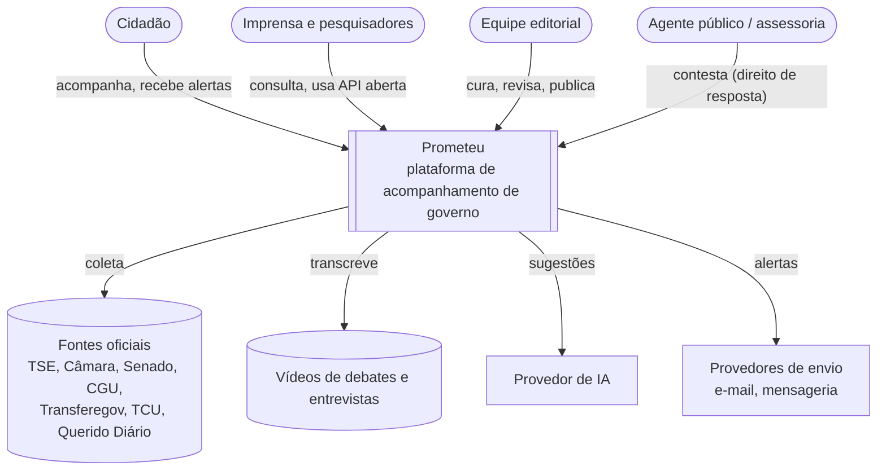
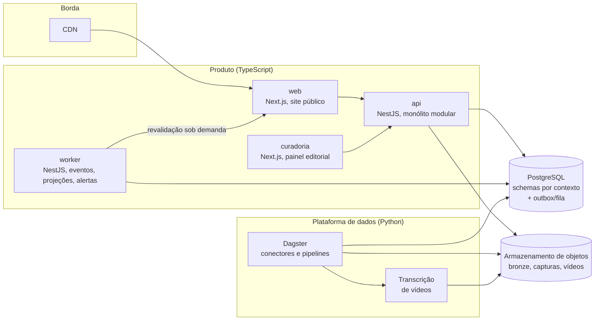
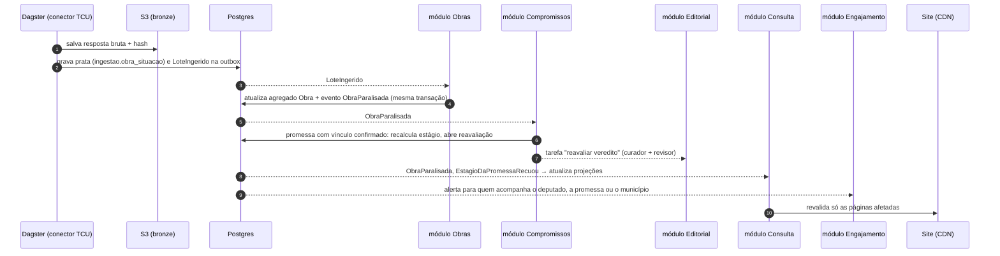

# Visão geral da arquitetura

> Documento de entrada. Explica **como o sistema é organizado e por quê**. Os detalhes de cada decisão estão
> nos [ADRs](../adr/README.md); o modelo de negócio está em [domínio](../dominio/mapa-de-contextos.md).

## Princípios

1. **O domínio manda.** A estrutura do código segue os contextos de negócio (DDD), não as tecnologias.
2. **Toda afirmação tem prova.** Nada é publicado sem fonte e captura imutável ([ADR-0009](../adr/0009-proveniencia-obrigatoria.md)).
3. **Fatos separados de julgamentos.** Estágio na cadeia (objetivo) ≠ veredito (editorial, com regras públicas).
4. **IA sugere, pessoa decide** ([ADR-0010](../adr/0010-ia-com-humano-no-circuito.md)).
5. **Fronteiras verificadas por máquina.** Regras de arquitetura rodam no CI; não dependem de boa vontade.
6. **Simples agora, extensível depois.** Monólito modular, com eventos e schemas próprios para extrair
   serviços quando os números pedirem ([ADR-0002](../adr/0002-monolito-modular.md)).
7. **Três esferas no modelo desde o primeiro dia**, mesmo começando pelo federal ([ADR-0012](../adr/0012-modelo-federativo-generico.md)).

## Nível 1: contexto do sistema (C4)



## Nível 2: contêineres



| Contêiner   | Responsabilidade                                                                                 | Escala                                            |
| ----------- | ------------------------------------------------------------------------------------------------ | ------------------------------------------------- |
| `web`       | Páginas públicas renderizadas no servidor, indexáveis, compartilháveis. Lê só projeções via API. | Horizontal; a maior parte do tráfego fica na CDN. |
| `curadoria` | Painel editorial: filas de sugestões, revisão, contestações, erratas.                            | Baixa carga.                                      |
| `api`       | Comandos (casos de uso) e consultas (projeções). API pública `/v1`. Sem estado.                  | Horizontal atrás de balanceador.                  |
| `worker`    | Relay da outbox, consumidores de eventos, atualização de projeções, envio de alertas, políticas. | Horizontal por fila.                              |
| `dagster`   | Coleta, bronze, prata, verificação de contrato das fontes, `LoteIngerido`.                       | Por conector, em lote.                            |
| `postgres`  | Fonte da verdade, fila de eventos (pg-boss), projeções.                                          | Vertical + réplicas de leitura + particionamento. |
| `objetos`   | Bronze, capturas, PDFs, vídeos, fotos de cidadãos.                                               | Ilimitado na prática.                             |

## Estrutura do repositório

```
prometeu/
├── apps/
│   ├── api/                  # Composição do monólito: importa os módulos e sobe HTTP
│   ├── worker/               # Mesmo código de módulos, outro ponto de entrada (consumidores e jobs)
│   ├── web/                  # Site público (Next.js)
│   └── curadoria/            # Painel editorial (Next.js)
│
├── modules/                  # Um pacote por contexto delimitado
│   ├── agentes-publicos/
│   ├── compromissos/         # ⭐ núcleo
│   │   └── src/
│   │       ├── domain/       # Promessa, Vinculo, Veredito, eventos, regras
│   │       ├── application/  # Casos de uso, portas
│   │       ├── infrastructure/  # Repositórios Drizzle, adaptadores de IA
│   │       ├── interface/    # Controllers, consumidores de eventos
│   │       └── index.ts      # ÚNICO ponto de entrada público do módulo
│   ├── atividade-legislativa/
│   ├── financas-publicas/
│   ├── obras/
│   ├── acervo/
│   ├── editorial/
│   ├── engajamento/
│   └── consulta/             # Projeções de leitura (CQRS)
│
├── packages/
│   ├── shared-kernel/        # Entity, AggregateRoot, ValueObject, DomainEvent, Result, Dinheiro, CodigoIbge
│   ├── contracts/            # JSON Schema de eventos, contratos da camada prata, OpenAPI
│   ├── ui/                   # Design system
│   └── config/               # tsconfig, eslint, regras de fronteira
│
├── data-platform/            # Python (uv)
│   ├── conectores/           # camara/, senado/, tse/, portal_transparencia/, transferegov/, tcu_obras/, ...
│   ├── pipelines/            # Ativos Dagster (bronze → prata)
│   ├── transcricao/          # Vídeos → transcrição segmentada
│   └── tests/                # Fixtures gravadas das fontes reais
│
├── infra/
│   ├── docker/               # docker-compose do ambiente local
│   └── terraform/            # Produção (quando ADR-0013 for aceito)
│
├── docs/                     # Arquitetura, domínio, ADRs, engenharia, pesquisa
└── .github/                  # CI, templates de PR e issue, CODEOWNERS
```

## Como um fato percorre o sistema

Exemplo: o TCU marca como paralisada uma obra paga com emenda de um deputado que prometeu essa obra.



## Escalabilidade

| Pressão                                           | Resposta da arquitetura                                                                  |
| ------------------------------------------------- | ---------------------------------------------------------------------------------------- |
| Pico de leitura (votação polêmica, notícia viral) | CDN + ISR; site lê projeções prontas; API sem estado escala horizontalmente.             |
| Mais fontes e esferas                             | Novo conector com o mesmo contrato prata; modelo federativo genérico.                    |
| Volume de dados (votos, despesas)                 | Particionamento por ano; projeções agregadas; réplicas de leitura.                       |
| Volume de eventos                                 | Trocar adaptador pg-boss por NATS/Kafka sem mexer no domínio.                            |
| Um contexto crescer muito                         | Extrair o módulo para serviço: já tem schema, eventos e API própria.                     |
| Capacidade editorial                              | IA para sugestões + filas priorizadas no painel; regra dos quatro olhos só onde importa. |

## Qualidade e operação

- **Observabilidade:** OpenTelemetry (traces, métricas, logs) com `idDeCorrelacao` atravessando API,
  eventos e pipelines; logs estruturados em JSON (pino no TypeScript, structlog no Python).
- **Qualidade de dados:** verificação de contrato diária por fonte; métricas de atualização por fonte;
  alertas quando um conector falha ou quando o volume foge do padrão.
- **Transparência operacional:** página pública de status das fontes ("Câmara: atualizado há 2 h").
- **Segurança:** OWASP ASVS como referência; segredos fora do código; limites de requisição na API
  pública; validação de toda entrada (Zod); varredura de dependências e de segredos no CI.
- **LGPD:** dados pessoais de agentes públicos limitados ao exercício da função; CPF nunca exposto;
  dados de cidadãos mínimos e com exclusão self-service; registro das operações de tratamento.
- **Auditoria:** histórico append-only de vereditos e log de ações da equipe editorial.

## Mapa da v1 para os módulos

| Entrega da v1                                          | Módulos envolvidos                                                                  |
| ------------------------------------------------------ | ----------------------------------------------------------------------------------- |
| Perfis dos 594 parlamentares federais                  | Agentes Públicos, Atividade Legislativa, Consulta                                   |
| Presença com motivo da ausência                        | Atividade Legislativa (+ conector de páginas de sessão da Câmara e dados do Senado) |
| Emendas até a obra                                     | Finanças Públicas, Obras, Consulta                                                  |
| Promessas 2027–2030 (presidente + governadores piloto) | Compromissos, Acervo (planos do TSE + transcrições de debates), Editorial           |
| "Meu governo" por município e alertas                  | Engajamento, Consulta                                                               |
| Painel editorial                                       | Editorial, Compromissos                                                             |
