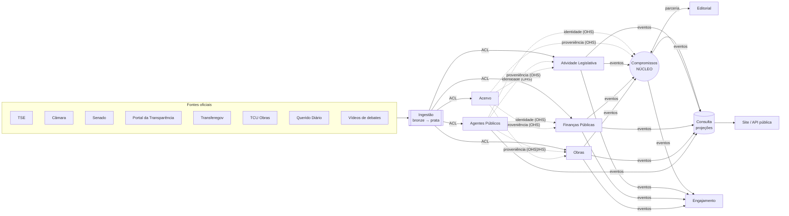

# Mapa de contextos (DDD estratégico)

> O sistema é dividido em **contextos delimitados** (bounded contexts). Cada um tem seu próprio modelo, sua
> própria linguagem, seu próprio schema no banco e sua própria API pública interna. Nenhum contexto lê ou
> escreve nas tabelas de outro. É isso que permite crescer sem virar um emaranhado.

## Subdomínios

| Tipo               | Subdomínio                                                                                        | Por quê                                                                                                                            |
| ------------------ | ------------------------------------------------------------------------------------------------- | ---------------------------------------------------------------------------------------------------------------------------------- |
| **Central** (core) | **Compromissos**                                                                                  | É o diferencial do produto: a cadeia promessa → ato → orçamento → execução → entrega. Recebe o melhor design e os melhores testes. |
| Suporte            | Agentes Públicos, Atividade Legislativa, Finanças Públicas, Obras, Acervo, Editorial, Engajamento | Necessários e específicos do nosso negócio, mas não são o diferencial por si sós.                                                  |
| Genérico           | Identidade e Acesso, Notificações (envio), Busca                                                  | Problemas resolvidos pelo mercado. Usamos soluções prontas atrás de portas (interfaces).                                           |

## Contextos delimitados

### 1. Agentes Públicos — `agentes-publicos`

Quem é quem no poder público. É a referência de identidade para todos os outros contextos.

- **Modelo:** `Pessoa`, `Candidatura`, `Mandato`, `Cargo`, `Partido`, `Filiacao`, `EnteFederativo`, `CasaLegislativa`, `IdentificadorExterno`.
- **Responsabilidade crítica:** **resolução de identidade**. A mesma pessoa tem um código no TSE, outro na Câmara, outro no Senado, outro no Portal da Transparência. Este contexto mantém a tabela de correspondência e é o único que pode dizer "estes registros são a mesma pessoa".
- **Regra de privacidade:** CPF e dados de familiares são usados apenas para resolução de identidade e **nunca** saem deste contexto.

### 2. Compromissos — `compromissos` ⭐ núcleo

Promessas e o rastreamento de sua entrega.

- **Modelo:** `Promessa` (agregado), `FonteDaPromessa`, `Trecho`, `Vinculo`, `Evidencia`, `Veredito`, `EstagioNaCadeia`, `Meta`.
- Detalhado em [modelo-compromissos.md](modelo-compromissos.md).

### 3. Atividade Legislativa — `atividade-legislativa`

O que acontece nas casas legislativas, de forma genérica para Câmara, Senado, assembleias e câmaras municipais.

- **Modelo:** `Proposicao`, `Tramitacao`, `Sessao`, `Votacao`, `Voto`, `Presenca`, `Ausencia` (com `MotivoDaAusencia`), `Autoria`.
- **Diferencial:** a ausência é um conceito de primeira classe, com motivo, fonte e data, e não um percentual solto.

### 4. Finanças Públicas — `financas-publicas`

O dinheiro: do planejamento ao pagamento.

- **Modelo:** `ProgramaPPA`, `AcaoOrcamentaria`, `Emenda` (individual, bancada, comissão, relator; a destinação da individual tem modalidade: finalidade definida ou transferência especial/PIX), `FavorecidosDaEmenda` (recebimentos mês a mês), `Convenio`, `PlanoDeTrabalho`, `Empenho`, `Liquidacao`, `Pagamento`, `Transferencia`, `Arrecadacao`.
- **Regra:** valores monetários sempre como `Dinheiro` (centavos inteiros + moeda). Nunca ponto flutuante.

### 5. Obras — `obras`

Entregas físicas.

- **Modelo:** `Obra` (com as emendas que a pagam, pelos empenhos), `SituacaoDaObra` (planejada, em execução, paralisada, concluída, cancelada, inacabada), `Medicao` (% executado), `Interrupcao`, `Localizacao`, `RegistroCidadao` (foto/relato moderado).
- **Relação com Finanças Públicas:** a obra guarda o código da emenda que vem no empenho; a Consulta junta as duas pelo código.

### 6. Acervo — `acervo`

Proveniência: a prova de tudo que publicamos.

- **Modelo:** `DocumentoFonte`, `Captura` (snapshot com hash SHA-256, data e URL), `Transcricao` (debates e entrevistas, com marcação de tempo), `SegmentoDeTranscricao`.
- **Regra:** nenhuma informação vai ao ar sem apontar para uma `Captura` imutável. Ver [ADR-0009](../adr/0009-proveniencia-obrigatoria.md).

### 7. Editorial — `editorial`

O processo humano que garante credibilidade.

- **Modelo:** `TarefaDeCuradoria`, `Revisao`, `Contestacao` (direito de resposta), `Errata`, `Sugestao` (produzida por IA, sempre pendente de decisão humana).
- **Regra dos quatro olhos:** vereditos sensíveis exigem um curador e um revisor diferentes.

### 8. Engajamento — `engajamento`

O cidadão e o motivo para ele voltar.

- **Modelo:** `Cidadao`, `Acompanhamento` (seguir um político, uma promessa, um município), `Alerta`, `PreferenciaDeCanal`, `MeuGoverno` (o recorte por município).

### 9. Ingestão — `data-platform` (Python)

Não é um contexto de negócio. É a **camada anticorrupção** com o mundo externo: conectores para cada fonte oficial, camadas bronze e prata. Ver [ADR-0005](../adr/0005-plataforma-de-dados-python.md).

### 10. Consulta — `consulta`

Lado de leitura (CQRS). Projeções desnormalizadas e otimizadas para o site e a API pública: perfil do político, linha do tempo da promessa, "meu governo". Não tem regra de negócio, só monta visões a partir de eventos. Ver [ADR-0008](../adr/0008-cqrs-projecoes-de-leitura.md).

## Relações entre contextos

| Relação                                       | Padrão                                                 | Significado                                                                                                                                            |
| --------------------------------------------- | ------------------------------------------------------ | ------------------------------------------------------------------------------------------------------------------------------------------------------ |
| Fontes oficiais → Ingestão → contextos        | **Camada Anticorrupção (ACL)**                         | O formato da Câmara, do TSE etc. nunca vaza para o domínio. Se a Câmara mudar a API (o que derrubou o Serenata de Amor), só o conector quebra.         |
| Agentes Públicos → todos                      | **Serviço de Host Aberto (OHS)** + linguagem publicada | Todos referenciam pessoas e mandatos por `PessoaId` / `MandatoId` publicados por este contexto.                                                        |
| Acervo → todos                                | **OHS**                                                | Todos referenciam provas por `CapturaId`.                                                                                                              |
| Legislativo / Finanças / Obras → Compromissos | **Cliente-Fornecedor** via eventos                     | Compromissos reage a fatos (`VotacaoConcluida`, `ExecucaoDaEmendaAtualizada`, `ObraParalisada`) para sugerir vínculos e atualizar o estágio da cadeia. |
| Compromissos ↔ Editorial                      | **Parceria**                                           | Evoluem juntos: o fluxo editorial governa as mudanças de veredito.                                                                                     |
| Todos → Consulta                              | **Conformista**                                        | Consulta só projeta eventos publicados, não influencia os modelos.                                                                                     |

## Eventos de integração principais

Eventos são fatos no passado, em português, versionados em `packages/contracts`.

| Evento                                                                | Publicado por         | Consumido por                       |
| --------------------------------------------------------------------- | --------------------- | ----------------------------------- |
| `LoteIngerido`                                                        | Ingestão              | contexto dono da fonte (importador) |
| `MandatoRegistrado`, `PeriodoDoMandatoRetificado`                     | Agentes Públicos      | Compromissos, Consulta, Engajamento |
| `ProposicaoRegistrada`, `TramitacaoAvancou`, `ProposicaoRetificada`   | Atividade Legislativa | Compromissos, Consulta, Engajamento |
| `VotacaoNominalRegistrada`, `VotacaoNominalRetificada`                | Atividade Legislativa | Compromissos, Consulta, Engajamento |
| `PresencaRegistrada`, `AusenciaRegistrada`, `FrequenciaRetificada`    | Atividade Legislativa | Consulta, Engajamento               |
| `EmendaRegistrada`, `ExecucaoDaEmendaAtualizada`, `EmendaRetificada`  | Finanças Públicas     | Compromissos, Consulta, Engajamento |
| `ObraParalisada`, `ObraConcluida`                                     | Obras                 | Compromissos, Consulta, Engajamento |
| `PromessaRegistrada`, `EstagioDaPromessaAvancou`, `VereditoPublicado` | Compromissos          | Consulta, Engajamento               |
| `ContestacaoRecebida`, `ErrataPublicada`                              | Editorial             | Consulta, Compromissos              |
