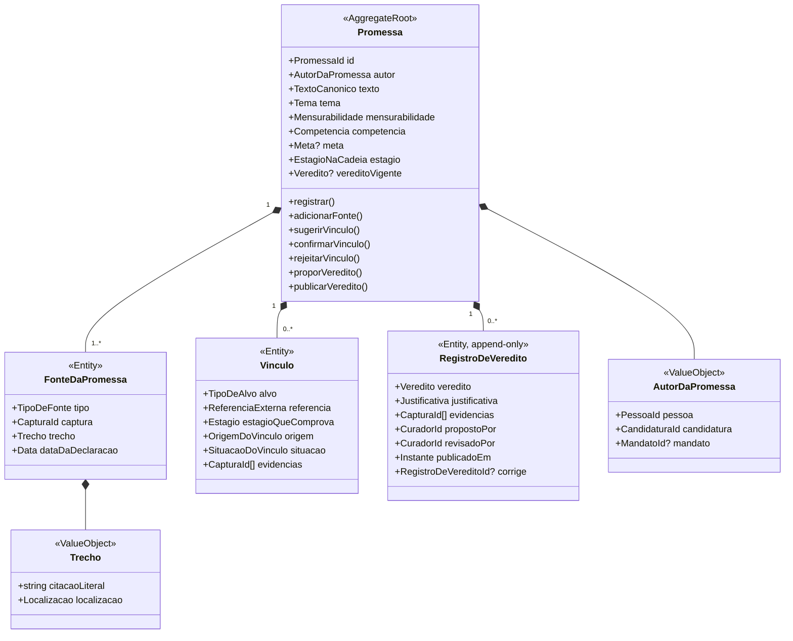
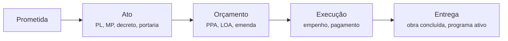
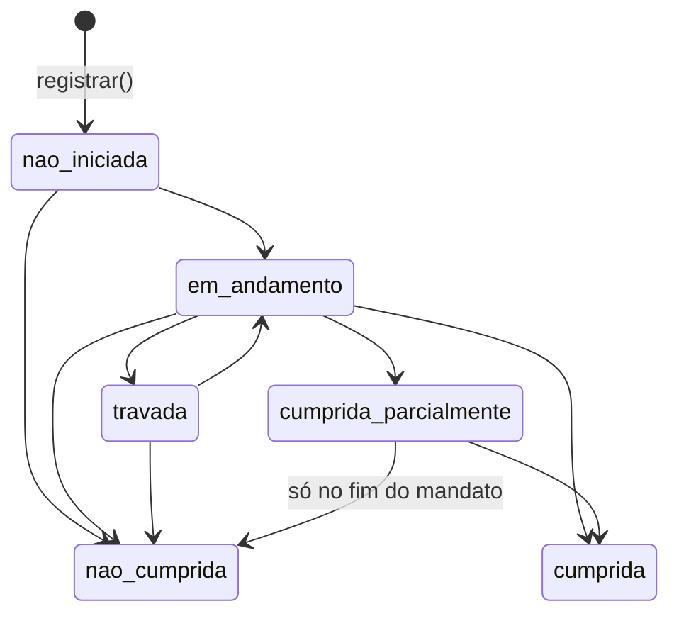

# Modelo do domínio central: Compromissos

> Este é o coração do produto. Tudo aqui é desenhado com DDD tático: agregados, objetos de valor,
> invariantes explícitas e eventos de domínio.

## Agregado `Promessa`

Uma promessa é a **unidade de consistência**: tudo que precisa mudar junto (fontes, vínculos, histórico de
estágio e veredito) vive dentro do agregado e só muda pelos métodos dele.

- `Localizacao` é `pagina` (PDF do plano de governo) ou `intervalo_de_tempo` (vídeo de debate: `00:41:12–00:41:47`).
- Referências a outros contextos são **somente por identificador** (`PessoaId`, `CapturaId`, `ProposicaoId`, `EmendaId`, `ObraId`). Um agregado nunca guarda o objeto de outro contexto.

## Duas dimensões: estágio e veredito

- **Estágio** é calculado: o estágio vigente é o mais avançado que tem ao menos um vínculo `confirmado`. Nem toda promessa passa por todos os estágios (ex.: "revogar o decreto X" vai de Prometida a Ato e já pode ser Entrega).
- Cada tipo de fato só comprova certos estágios:

  | Tipo de fato        | Estágios que pode comprovar |
  | ------------------- | --------------------------- |
  | `proposicao`        | Ato                         |
  | `ato_normativo`     | Ato, Entrega                |
  | `acao_orcamentaria` | Orçamento, Execução         |
  | `emenda`            | Orçamento, Execução         |
  | `obra`              | Execução, Entrega           |

- Vínculo confirmado pode ser rejeitado depois (ex.: PL arquivado), com motivo. O estágio então recua.
- **Veredito** é editorial e segue a máquina de estados abaixo. Antes do primeiro veredito publicado, a
  promessa está `nao_iniciada`.

### Fluxo do veredito

1. O curador **propõe** (`VereditoProposto`). Só existe uma proposta pendente por promessa.
2. Quem revisa **publica** (`VereditoPublicado`) ou **recusa** com motivo (`VereditoRecusado`). O próprio
   curador pode recusar a sua proposta para retirá-la.
3. `nao_iniciada` e `em_andamento` podem ser publicados pelo próprio curador; os demais exigem outra pessoa.
4. **Errata:** corrige o veredito vigente quando a avaliação estava errada. Pode sair de qualquer estado
   (inclusive `cumprida` e `nao_cumprida`, que são finais na máquina de estados), sempre exige revisão de
   outra pessoa e gera um registro novo que aponta para o corrigido em `corrige`.

## Invariantes (regras que o agregado garante)

1. Toda promessa tem **ao menos uma fonte**, e toda fonte aponta para uma **captura** do Acervo com trecho literal.
2. Um vínculo `sugerido` (por IA ou curador) **não altera** estágio nem veredito. Só vínculos `confirmados` contam.
3. Todo veredito tem justificativa textual e ao menos uma evidência (captura). Publicar `cumprida`,
   `cumprida_parcialmente`, `nao_cumprida`, `travada` ou uma errata exige, além disso, **revisor diferente
   do curador** (regra dos quatro olhos).
4. `nao_cumprida` só pode ser publicada se o mandato terminou, **ou** se houve ato em sentido contrário com evidência.
   A data de fim do mandato vem de Agentes Públicos, não de quem propõe. A partir de `cumprida_parcialmente`,
   só o fim do mandato vale.
5. O histórico de vereditos é **append-only**. Corrigir significa publicar um novo registro com referência à errata, nunca apagar.
6. Promessa `generica` pode receber estágio, mas não recebe `cumprida` (não há como verificar). Ela é exibida como "genérica, não verificável".
7. `fora_da_competencia` não impede o acompanhamento; é exibido como contexto educativo.

## Eventos de domínio

| Evento                                                 | Quando                                                                |
| ------------------------------------------------------ | --------------------------------------------------------------------- |
| `PromessaRegistrada`                                   | Promessa criada a partir de fonte (manual ou sugestão aceita).        |
| `FonteAdicionada`                                      | Nova fonte para a mesma promessa (ex.: repetida em debate).           |
| `VinculoSugerido`                                      | IA ou curador propõe ligação com um fato.                             |
| `VinculoConfirmado` / `VinculoRejeitado`               | Decisão humana sobre a sugestão.                                      |
| `EstagioDaPromessaAvancou` / `EstagioDaPromessaRecuou` | Recalculado após confirmação/rejeição de vínculo (ex.: PL arquivado). |
| `VereditoProposto`                                     | Curador propõe. Gera tarefa de revisão no Editorial.                  |
| `VereditoRecusado`                                     | Revisor devolve a proposta com motivo (ou o curador a retira).        |
| `VereditoPublicado`                                    | Revisor aprova. Vai para projeções e alertas.                         |

## Políticas (reações automáticas a eventos de outros contextos)

| Ao receber                                                      | Compromissos faz                                                                          |
| --------------------------------------------------------------- | ----------------------------------------------------------------------------------------- |
| `ProposicaoApresentada`                                         | Busca promessas semanticamente próximas do mesmo autor/governo e cria `VinculoSugerido`.  |
| `TramitacaoAvancou` (sanção, arquivamento)                      | Se houver vínculo confirmado, recalcula estágio e abre tarefa de reavaliação de veredito. |
| `ExecucaoDaEmendaAtualizada`, `ObraParalisada`, `ObraConcluida` | Idem, para vínculos de orçamento, execução e entrega.                                     |
| `MandatoEncerrado`                                              | Abre tarefa de veredito final para todas as promessas não concluídas do mandato.          |

> Políticas **nunca** publicam veredito sozinhas. No máximo sugerem e abrem tarefa. Quem decide é uma pessoa.
