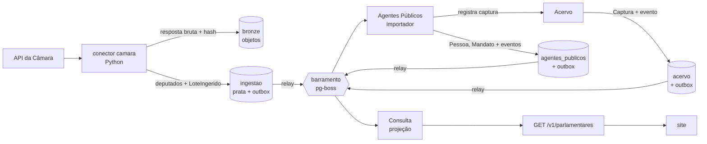

# Roteiro da v1

> A ordem das etapas segue um princípio: **provar a arquitetura inteira cedo, com pouco código**, e só
> depois multiplicar os módulos. Cada etapa atravessa todas as camadas (fonte oficial → bronze → prata →
> domínio → eventos → projeção → API → site) e termina com algo que funciona de ponta a ponta.

O que a v1 entrega e quais módulos cada entrega envolve está em
[visão geral da arquitetura](arquitetura/visao-geral.md#mapa-da-v1-para-os-módulos).

## Por que esta ordem

- **Fatia vertical antes de camada horizontal.** As decisões mais arriscadas (ADRs 0005 a 0009) só se
  provam juntas: conector, contrato prata, importador, outbox, barramento, projeção e revalidação do site.
  Testá-las cedo, com um único fluxo, é barato; descobrir um encaixe errado com nove módulos prontos não é.
- **Leitura de dados públicos antes de escrita editorial.** Dados oficiais não dependem de login. Os
  comandos editoriais (registrar promessa, publicar veredito) têm autor e só vão para a API depois de
  definido o controle de acesso ([ADR-0014](adr/0014-identidade-e-acesso.md)).
- **Proveniência desde o primeiro conector.** Nada vai ao ar sem captura ([ADR-0009](adr/0009-proveniencia-obrigatoria.md)).
  Adaptar conectores depois custa mais do que nascer certo.
- **Identidade primeiro.** Todos os contextos referenciam `PessoaId` e `MandatoId`; Agentes Públicos é a
  base dos demais.

## Etapas

| #   | Etapa                                       | Entrega                                                                                                                                                                           | Situação  |
| --- | ------------------------------------------- | --------------------------------------------------------------------------------------------------------------------------------------------------------------------------------- | --------- |
| 0   | Domínio central: Compromissos               | Agregado `Promessa` (estágio, veredito, errata) e casos de uso, só com testes, sem infraestrutura.                                                                                | Concluída |
| 1   | Fatia de ponta a ponta: deputados da Câmara | Conector da Câmara com captura; Agentes Públicos (`Pessoa`, `Mandato`); Acervo mínimo; outbox, barramento e inbox; projeção em Consulta; `GET /v1/parlamentares`; página no site. | Concluída |
| 2   | Compromissos no banco e acesso editorial    | Repositório da `Promessa` com outbox; login e papéis (aceitar ADR-0014); painel mínimo de curadoria para cadastrar promessa e propor veredito.                                    | Concluída |
| 3   | Atividade Legislativa                       | Proposições, votações e presença com o motivo da ausência (Câmara e Senado).                                                                                                      | Concluída |
| 4   | Finanças Públicas e Obras                   | Emenda até a obra: empenho, pagamento, situação e medição da obra.                                                                                                                | Em curso  |
| 5   | Compromissos ligado aos fatos               | Sugestão de vínculos a partir dos eventos de Legislativo, Finanças e Obras; reavaliação do estágio.                                                                               | A fazer   |
| 6   | Engajamento                                 | "Meu governo" por município, acompanhar político ou promessa, alertas.                                                                                                            | A fazer   |

Cada etapa só termina com CI verde, testes de integração contra Postgres real e documentação de domínio
e de contratos atualizada.

## Etapa 1 em detalhe

1. Contrato prata `camara_deputado` e conector com testes sobre respostas gravadas.
2. Infraestrutura comum: transação por contexto, outbox, relay, barramento e inbox (ADR-0015).
3. Acervo mínimo: `Captura` registrada de forma idempotente pelo hash (ADR-0016).
4. Agentes Públicos: `Pessoa` com identificadores externos, filiação e mandatos; importador da prata.
5. Consulta: projeção `parlamentar`, reconstruível a partir dos eventos.
6. API pública `/v1/parlamentares` e páginas de lista e perfil no site, com a fonte de cada dado.
7. Testes de integração com Postgres real no CI.

Resultado: com a API da Câmara real, 513 deputados chegaram da fonte ao site, com a captura de cada dado.
A coleta, a importação e a projeção levam menos de um minuto.

Fica para depois, de propósito: Senado e assembleias (mesmo contrato, novos conectores), CPF e resolução de
identidade entre fontes, revalidação sob demanda do site, observabilidade completa, comando para reconstruir
projeções, limite de requisições na API pública e gravação de respostas reais da Câmara como fixtures dos
testes de contrato.

## Etapa 2 em detalhe

- **Compromissos no banco:** repositório da `Promessa` com controle de versão (concorrência otimista),
  eventos na outbox e histórico de vereditos protegido por gatilho no banco (invariante 5).
- **Identidade:** Keycloak com o realm `prometeu` ([ADR-0014](adr/0014-identidade-e-acesso.md)). A API
  confere assinatura, emissor e audiência do token e exige papel por rota.
- **API editorial** (`/v1/editorial`): registrar promessa, adicionar fonte, capturar documento, propor,
  publicar e recusar veredito. O autor de cada ato vem do token, nunca do corpo da requisição.
- **Captura de documentos:** o Acervo baixa o documento da URL informada (só https, sem rede interna,
  conferindo o IP também na conexão), guarda pelo hash e registra a captura.
- **Painel de curadoria:** login com PKCE, sessão em cookie cifrado, lista de promessas, cadastro com
  captura da fonte, proposta, publicação e recusa de veredito.

Resultado: a jornada completa (login real, captura de uma página real, registro, proposta, recusa de "não
cumprida" com mandato em curso, publicação por outra pessoa) roda contra os serviços locais.

Fica para depois, de propósito: vínculos pelo painel (etapa 5), OTP obrigatório no realm de produção,
fila de revisão com filtros, renovação de sessão gravada também nas páginas (hoje só em ações e rotas) e o
sistema visual do painel.

## Etapa 3 em detalhe

A etapa é grande; vai em fatias, cada uma de ponta a ponta. A ordem começa pelo diferencial do produto (a
ausência com motivo) e deixa o Senado para quando os senadores estiverem em Agentes Públicos.

| Fatia | Entrega                                                                                                                                        | Situação  |
| ----- | ---------------------------------------------------------------------------------------------------------------------------------------------- | --------- |
| 3.1   | Frequência no plenário da Câmara, com o motivo de cada ausência justificada: conector, `RegistroDeFrequencia`, projeção, API e perfil no site. | Concluída |
| 3.2   | Votações nominais do plenário da Câmara e o voto de cada deputado; antes, os períodos de exercício dos deputados (inclusive suplentes).        | Concluída |
| 3.3   | Senado: senadores e seus exercícios em Agentes Públicos, votações nominais e quem não votou, com o motivo, em cada votação.                    | Concluída |
| 3.4   | Proposições normativas (PEC, PLP, PL, MPV, PDL) da Câmara e do Senado: autoria, situação e tramitação, ligadas às votações.                    | Concluída |

### Fatia 3.1: frequência na Câmara

- **Fonte:** a API de Dados Abertos v2 não publica a justificativa da ausência. Ela só existe no serviço
  legado SitCamaraWS (`ListarPresencasParlamentar`), consultado por matrícula. O conector também grava a
  correspondência entre matrícula e id da API v2. Cada consulta leva vários segundos; quatro correm ao
  mesmo tempo.
- **Janela:** a justificativa costuma chegar dias depois da sessão, então cada execução revisita os
  últimos 30 dias. Regravar o dia atualiza a prata, e o domínio transforma a mudança em retificação.
- **Domínio:** `RegistroDeFrequencia` por pessoa, casa e dia de sessão. Só a ausência justificada tem
  motivo; o dia precisa cair dentro do mandato, que Agentes Públicos informa pelo código da fonte.
- **Falta de dado não é falta:** a Câmara responde 404 para algumas matrículas, e o conector não grava
  nada. A API conta dias com sessão registrados; dia sem registro não entra em nenhuma conta.
- **Leitura:** `GET /v1/parlamentares/{pessoaId}/frequencia?de=&ate=` (padrão: últimos 90 dias) e a
  seção "Presença no plenário" no perfil, com o motivo e a fonte de cada ausência.

Resultado: com o serviço real da Câmara, a coleta dos últimos 30 dias levou 28 minutos e trouxe 2.560 dias
de 513 deputados (o plenário quase não teve sessão durante a campanha eleitoral, então os dias começam em
13/10). A importação e a projeção levaram cerca de um minuto, sem nenhuma linha recusada: 49 ausências
justificadas (missão autorizada e licença para tratamento de saúde) e 56 sem justificativa.

Fica para depois, de propósito: o significado de "Presença (~)" (sem legenda pública; a grafia é
guardada e tratada como presença), frequência em comissões e o histórico anterior à janela de 30 dias
(uma carga inicial por legislatura).

### Fatia 3.2: votações nominais na Câmara

- **Pré-requisito descoberto na fonte:** as três votações nominais de outubro tinham votos de suplentes
  que já tinham saído do cargo, e Agentes Públicos só conhecia quem estava em exercício no dia da coleta.
  O conector de deputados passou a percorrer todos os deputados da legislatura e a ler o histórico de
  cada um (posse, licença, reassunção, afastamento). Cada período de exercício vira um mandato, como diz a
  definição do domínio; o mandato antigo, que cobria a legislatura inteira, é retificado para o primeiro
  exercício e mantém o id (`PeriodoDoMandatoRetificado`). A lista de parlamentares do site mostra só quem
  está no cargo hoje; quem saiu mantém o perfil.
- **Fonte:** `GET /api/v2/votacoes?idOrgao=180` lista as votações do plenário. Só as nominais têm votos
  (`/votacoes/{id}/votos`); o detalhe traz as proposições afetadas. Os votos de uma votação ficam numa
  linha da prata, para que uma correção da Câmara não deixe voto velho para trás. Na votação secreta a
  fonte diz quem votou, com o voto nulo.
- **Domínio:** `VotacaoNominal`, com o voto de cada parlamentar ligado ao mandato exercido no instante do
  voto. Um parlamentar desconhecido recusa a votação inteira, para que o placar nunca fique incompleto.
  Cada um vota uma vez, e o sigilo vale para todos os votos ou para nenhum.
- **Ausente não é inferido:** a Câmara não lista quem faltou à votação. No perfil entram as votações em
  que o parlamentar votou e as dos dias em que a casa apurou a frequência dele; sem voto, o site mostra
  como o dia foi apurado (presente, ausente, ausência justificada e o motivo), sem adivinhar.
- **Leitura:** `GET /v1/votacoes`, `GET /v1/votacoes/{votacaoId}` (placar, votos e as duas fontes) e
  `GET /v1/parlamentares/{pessoaId}/votos`; páginas "Votações nominais" e a seção no perfil.

Resultado: com a fonte real, o histórico de 648 deputados (incluindo 135 que já saíram) levou pouco mais
de um minuto e virou 963 mandatos, sem recusa: 513 mandatos antigos foram retificados e a lista do site
continuou com 513 em exercício. A coleta das votações de agosto a outubro trouxe 11 votações nominais
(uma secreta, com 466 votos sem conteúdo) e nenhuma recusada; os placares batem com a descrição da
Câmara.

Fica para depois, de propósito: orientação de bancada (`/votacoes/{id}/orientacoes`), votações em
comissões, a frequência dos suplentes que já saíram (o serviço legado só lista quem está em exercício) e
o vínculo da votação com a proposição, que vem na fatia 3.4.

### Fatia 3.3: Senado

- **Senadores:** como na Câmara, a lista de quem está em exercício não basta. O conector percorre os
  senadores da legislatura em curso e lê os mandatos de cada um, que trazem os exercícios (início, fim e
  causa do afastamento). A UF vem do mandato: o detalhe de quem já saiu não a traz. A API do Senado
  recusa conexões quando recebe muitas consultas ao mesmo tempo; elas vão uma de cada vez (13 segundos
  para os 245 senadores da legislatura 57, 107 deles com exercício nela).
- **Exercício que se toca no mesmo dia:** o Senado às vezes encerra um exercício e abre o seguinte da
  mesma pessoa no mesmo dia (o titular renuncia e o suplente, que já estava no cargo, continua). A
  prata guarda as datas como vieram; Agentes Públicos junta os dois num mandato só.
- **Votações:** uma consulta traz as votações nominais da janela, cada uma com todos os senadores em
  exercício. Quem não votou vem com a situação: presente sem voto (`P-NRV`), não compareceu (`NCom`),
  ou ausente com motivo (`AP`, `LS`, `MIS`, `LP`, `LAP`). `NA` ("Dispositivo não citado") não tem
  legenda pública e é guardada como situação não informada.
- **Domínio:** `VotacaoNominal` passou a registrar, quando a casa informa, quem não votou e por quê
  (relação completa). Na Câmara a relação continua incompleta e nada é inferido. O Senado não informa
  horário: o voto vale para o mandato exercido no dia. Os eventos da votação foram para a v2 do
  contrato; a projeção lê a v1 e a v2.
- **Leitura:** `GET /v1/votacoes?casa=senado`, a lista "Não votaram" na página da votação e, no
  perfil, o motivo que a própria votação informa. O perfil do senador não mostra "Presença no
  plenário": a frequência diária do Senado não é coletada.

- **Licença antes da posse do suplente:** o Senado continua listando o titular de licença, com o motivo,
  até o suplente tomar posse, embora o exercício dele já tenha terminado. A ausência justificada fica
  ligada ao último exercício, encerrado pela licença; as outras situações exigem mandato no dia.

Resultado: com a fonte real, os 107 senadores com exercício na legislatura viraram 107 pessoas
(a última depois de traduzir `S/Partido`, como o Senado escreve "sem partido") e 81 em exercício, o
mesmo número da lista do Senado. As 190 votações nominais de 2025 e 2026 entraram todas, depois de tratar a licença
antes da posse do suplente, que recusava três votações: 15.390 registros (190 × 81), com 1.962 ausências
justificadas (atividade parlamentar, licença saúde, missão, licença particular, licença paternidade), 73
ausências sem justificativa e 2.391 presentes sem voto. Coletar de novo não gerou evento.

Fica para depois, de propósito: unificar a pessoa que foi deputada e virou senadora (as fontes não têm
identificador comum, e juntar pelo nome confundiria homônimos) e a frequência diária do Senado.

### Fatia 3.4: proposições

- **Recorte:** só os tipos que podem virar norma (PEC, PLP, PL, MPV e PDL). Requerimentos, pareceres e
  outros documentos de trâmite seriam metade do volume e não viram lei. Na Câmara, entram as
  proposições com tramitação nos últimos 3 dias; no Senado, os processos atualizados nesse período.
  Tramitação não muda depois de registrada, e três dias cobrem um fim de semana sem execução.
- **Fontes:** na Câmara, três consultas por proposição (detalhe, autores e tramitações), quatro ao
  mesmo tempo: com oito, a Câmara responde 429, e o cliente HTTP agora espera o que a fonte pede em
  `Retry-After`. No Senado, uma consulta por processo traz autoria, situação, histórico de situações e
  norma gerada.
- **O que a fonte ensinou:** a sequência da tramitação na Câmara não é única (dois despachos do mesmo
  ato repetem o número) e nem sempre acompanha a data; o importador ordena por data, de forma estável.
  No Senado, o código do autor só identifica senadores: um deputado autor vem com o código do Senado.
- **Domínio:** `Proposicao`, uma por casa. O autor parlamentar é ligado à pessoa quando Agentes
  Públicos o conhece; quem não é parlamentar conhecido (Poder Executivo, comissão, ex-parlamentar)
  fica com o nome da fonte. Ato novo depois dos conhecidos vira `TramitacaoAvancou`; outra correção da
  casa, `ProposicaoRetificada`.
- **Votação e proposição:** a votação aponta a matéria pelo código da casa; no Senado, as votações
  passaram a trazer o id do processo (contrato v1.1.0), o mesmo das proposições. A página da votação
  liga para a proposição quando ela já foi coletada, e a da proposição lista as votações.
- **Leitura:** `GET /v1/proposicoes?casa=&tipo=`, `GET /v1/proposicoes/{id}` e
  `GET /v1/parlamentares/{id}/proposicoes`; páginas de proposições, da proposição e a seção
  "Proposições de autoria" no perfil.

Resultado: com a fonte real, a coleta dos últimos 3 dias levou 12 minutos e trouxe 1.735 proposições da
Câmara e 271 do Senado, todas importadas sem recusa, com 18.681 atos de tramitação. Dos autores, 2.135 de
2.323 na Câmara e 335 de 555 no Senado ficaram ligados a pessoas; os demais são comissões, a Presidência
da República e ex-parlamentares. As 190 votações do Senado coletadas de novo passaram a apontar o
processo; 5 delas já ligam a uma proposição coletada, e o número cresce com a coleta diária.

Fica para depois, de propósito: ligar a mesma matéria nas duas casas, a carga histórica (só entra o
que se move desde o início da coleta), relatorias e as proposições acessórias (emendas, pareceres).

## Etapa 4 em detalhe

O caminho do dinheiro, em fatias de ponta a ponta. Começa pela emenda, que liga o parlamentar ao
orçamento, e chega à obra.

| Fatia | Entrega                                                                                                                        | Situação  |
| ----- | ------------------------------------------------------------------------------------------------------------------------------ | --------- |
| 4.1   | Emendas parlamentares do Portal da Transparência: autor, destinações e execução (empenhado, liquidado, pago e restos a pagar). | Concluída |
| 4.2   | Para quem o dinheiro foi: favorecidos e convênios de cada emenda, com o município de destino.                                  | A fazer   |
| 4.3   | Obras: situação e medição, ligadas à emenda e à ação orçamentária que as pagam.                                                | A fazer   |

### Fatia 4.1: emendas parlamentares

- **Fonte:** o arquivo único de emendas do Portal da Transparência (um ZIP com um CSV em latin-1),
  coletado por inteiro todo dia. Entram os orçamentos de 2023 em diante. Cada linha é uma destinação
  (localidade e classificação orçamentária, até o plano orçamentário) com a execução acumulada; as
  linhas do mesmo código formam a emenda. Valores viram centavos inteiros já na plataforma de dados.
- **O que a fonte ensinou:** o Portal junta o tipo da emenda e a modalidade no mesmo campo, linha a
  linha, e 55 emendas individuais têm destinações nas duas modalidades. O tipo ficou na emenda
  (`individual`, `bancada`, `comissao`, `relator`) e a modalidade (`finalidade_definida` ou
  `transferencia_especial`, a "emenda PIX") em cada destinação. Município e UF sem código IBGE vêm
  como `Sem informação`, `-1` ou `-14` e ficam nulos.
- **Autor:** o Portal identifica o parlamentar só pelo nome. Agentes Públicos, que decide quem é quem,
  oferece os parlamentares em exercício num período; a emenda é ligada quando o nome normalizado
  corresponde a um único deputado ou senador em exercício no ano anterior ao do orçamento, quando a
  emenda é proposta. Sem correspondência única, fica o nome da fonte, sem recusar a emenda.
- **Domínio:** `Emenda`, com as destinações e a execução em `Dinheiro`. Valores novos da fonte viram
  `ExecucaoDaEmendaAtualizada`; outra correção (destino, classificação, modalidade, autor),
  `EmendaRetificada`. Só o estorno de restos a pagar cancelados pode ser negativo.
- **Leitura:** `GET /v1/emendas?ano=&tipo=&uf=`, `GET /v1/emendas/{id}` e
  `GET /v1/parlamentares/{id}/emendas`, com a execução somada de todas as emendas do autor. Valores
  em centavos, como texto. No site, a lista, a página da emenda e a seção "Emendas ao orçamento" no
  perfil; "pago até agora" soma o pago no ano e os restos a pagar pagos depois.

Resultado: com a fonte real, a coleta levou 33 segundos e a importação, um minuto: 25.131 emendas, todas
importadas sem recusa. As individuais somam cerca de R$ 24 bilhões empenhados por ano. Dos autores de
emendas individuais, 99% ficaram ligados a pessoas nos orçamentos de 2024 a 2026 (18.086 de 18.279); no
de 2023, só 522 de 5.575, porque quem as propôs em 2022 era da legislatura anterior, que Agentes Públicos
ainda não conhece.

Fica para depois, de propósito: os parlamentares da legislatura 2019-2023 (para ligar os autores do
orçamento de 2023), os favorecidos e convênios (fatia 4.2) e os orçamentos anteriores a 2023.
