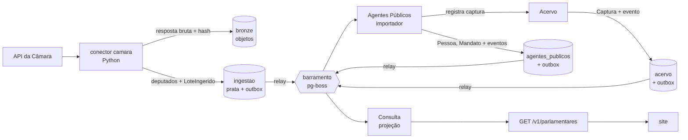

# Roteiro da v1

> A ordem das etapas segue um princípio: **provar a arquitetura inteira cedo, com pouco código**, e só
> depois multiplicar os módulos. Cada etapa atravessa todas as camadas (fonte oficial → bronze → prata →
> domínio → eventos → projeção → API → site) e termina com algo que funciona de ponta a ponta.

O que a v1 entrega e quais módulos cada entrega envolve está em
[visão geral da arquitetura](arquitetura/visao-geral.md#mapa-da-v1-para-os-módulos).

## Por que esta ordem

- **Fatia vertical antes de camada horizontal.** As decisões mais arriscadas (ADRs 0005 a 0009) só se
  provam juntas: conector, contrato prata, importador, outbox, barramento, projeção e revalidação do site.
  Testá-las cedo, com um único fluxo, é barato; descobrir um encaixe errado com nove módulos prontos não é.
- **Leitura de dados públicos antes de escrita editorial.** Dados oficiais não dependem de login. Os
  comandos editoriais (registrar promessa, publicar veredito) têm autor e só vão para a API depois de
  definido o controle de acesso ([ADR-0014](adr/0014-identidade-e-acesso.md)).
- **Proveniência desde o primeiro conector.** Nada vai ao ar sem captura ([ADR-0009](adr/0009-proveniencia-obrigatoria.md)).
  Adaptar conectores depois custa mais do que nascer certo.
- **Identidade primeiro.** Todos os contextos referenciam `PessoaId` e `MandatoId`; Agentes Públicos é a
  base dos demais.

## Etapas

| #   | Etapa                                       | Entrega                                                                                                                                                                           | Situação  |
| --- | ------------------------------------------- | --------------------------------------------------------------------------------------------------------------------------------------------------------------------------------- | --------- |
| 0   | Domínio central: Compromissos               | Agregado `Promessa` (estágio, veredito, errata) e casos de uso, só com testes, sem infraestrutura.                                                                                | Concluída |
| 1   | Fatia de ponta a ponta: deputados da Câmara | Conector da Câmara com captura; Agentes Públicos (`Pessoa`, `Mandato`); Acervo mínimo; outbox, barramento e inbox; projeção em Consulta; `GET /v1/parlamentares`; página no site. | Concluída |
| 2   | Compromissos no banco e acesso editorial    | Repositório da `Promessa` com outbox; login e papéis (aceitar ADR-0014); painel mínimo de curadoria para cadastrar promessa e propor veredito.                                    | Concluída |
| 3   | Atividade Legislativa                       | Proposições, votações e presença com o motivo da ausência (Câmara e Senado).                                                                                                      | Em curso  |
| 4   | Finanças Públicas e Obras                   | Emenda até a obra: empenho, pagamento, situação e medição da obra.                                                                                                                | A fazer   |
| 5   | Compromissos ligado aos fatos               | Sugestão de vínculos a partir dos eventos de Legislativo, Finanças e Obras; reavaliação do estágio.                                                                               | A fazer   |
| 6   | Engajamento                                 | "Meu governo" por município, acompanhar político ou promessa, alertas.                                                                                                            | A fazer   |

Cada etapa só termina com CI verde, testes de integração contra Postgres real e documentação de domínio
e de contratos atualizada.

## Etapa 1 em detalhe

1. Contrato prata `camara_deputado` e conector com testes sobre respostas gravadas.
2. Infraestrutura comum: transação por contexto, outbox, relay, barramento e inbox (ADR-0015).
3. Acervo mínimo: `Captura` registrada de forma idempotente pelo hash (ADR-0016).
4. Agentes Públicos: `Pessoa` com identificadores externos, filiação e mandatos; importador da prata.
5. Consulta: projeção `parlamentar`, reconstruível a partir dos eventos.
6. API pública `/v1/parlamentares` e páginas de lista e perfil no site, com a fonte de cada dado.
7. Testes de integração com Postgres real no CI.

Resultado: com a API da Câmara real, 513 deputados chegaram da fonte ao site, com a captura de cada dado.
A coleta, a importação e a projeção levam menos de um minuto.

Fica para depois, de propósito: Senado e assembleias (mesmo contrato, novos conectores), CPF e resolução de
identidade entre fontes, revalidação sob demanda do site, observabilidade completa, comando para reconstruir
projeções, limite de requisições na API pública e gravação de respostas reais da Câmara como fixtures dos
testes de contrato.

## Etapa 2 em detalhe

- **Compromissos no banco:** repositório da `Promessa` com controle de versão (concorrência otimista),
  eventos na outbox e histórico de vereditos protegido por gatilho no banco (invariante 5).
- **Identidade:** Keycloak com o realm `prometeu` ([ADR-0014](adr/0014-identidade-e-acesso.md)). A API
  confere assinatura, emissor e audiência do token e exige papel por rota.
- **API editorial** (`/v1/editorial`): registrar promessa, adicionar fonte, capturar documento, propor,
  publicar e recusar veredito. O autor de cada ato vem do token, nunca do corpo da requisição.
- **Captura de documentos:** o Acervo baixa o documento da URL informada (só https, sem rede interna,
  conferindo o IP também na conexão), guarda pelo hash e registra a captura.
- **Painel de curadoria:** login com PKCE, sessão em cookie cifrado, lista de promessas, cadastro com
  captura da fonte, proposta, publicação e recusa de veredito.

Resultado: a jornada completa (login real, captura de uma página real, registro, proposta, recusa de "não
cumprida" com mandato em curso, publicação por outra pessoa) roda contra os serviços locais.

Fica para depois, de propósito: vínculos pelo painel (etapa 5), OTP obrigatório no realm de produção,
fila de revisão com filtros, renovação de sessão gravada também nas páginas (hoje só em ações e rotas) e o
sistema visual do painel.

## Etapa 3 em detalhe

A etapa é grande; vai em fatias, cada uma de ponta a ponta. A ordem começa pelo diferencial do produto (a
ausência com motivo) e deixa o Senado para quando os senadores estiverem em Agentes Públicos.

| Fatia | Entrega                                                                                                                                        | Situação  |
| ----- | ---------------------------------------------------------------------------------------------------------------------------------------------- | --------- |
| 3.1   | Frequência no plenário da Câmara, com o motivo de cada ausência justificada: conector, `RegistroDeFrequencia`, projeção, API e perfil no site. | Concluída |
| 3.2   | Votações nominais do plenário da Câmara e o voto de cada deputado.                                                                             | A fazer   |
| 3.3   | Senado: senadores em Agentes Públicos, votações nominais e as ausências com motivo que o Senado publica em cada votação.                       | A fazer   |
| 3.4   | Proposições, autoria e tramitação (Câmara e Senado).                                                                                           | A fazer   |

### Fatia 3.1: frequência na Câmara

- **Fonte:** a API de Dados Abertos v2 não publica a justificativa da ausência. Ela só existe no serviço
  legado SitCamaraWS (`ListarPresencasParlamentar`), consultado por matrícula. O conector também grava a
  correspondência entre matrícula e id da API v2. Cada consulta leva vários segundos; quatro correm ao
  mesmo tempo.
- **Janela:** a justificativa costuma chegar dias depois da sessão, então cada execução revisita os
  últimos 30 dias. Regravar o dia atualiza a prata, e o domínio transforma a mudança em retificação.
- **Domínio:** `RegistroDeFrequencia` por pessoa, casa e dia de sessão. Só a ausência justificada tem
  motivo; o dia precisa cair dentro do mandato, que Agentes Públicos informa pelo código da fonte.
- **Falta de dado não é falta:** a Câmara responde 404 para algumas matrículas, e o conector não grava
  nada. A API conta dias com sessão registrados; dia sem registro não entra em nenhuma conta.
- **Leitura:** `GET /v1/parlamentares/{pessoaId}/frequencia?de=&ate=` (padrão: últimos 90 dias) e a
  seção "Presença no plenário" no perfil, com o motivo e a fonte de cada ausência.

Resultado: com o serviço real da Câmara, a coleta dos últimos 30 dias levou 28 minutos e trouxe 2.560 dias
de 513 deputados (o plenário quase não teve sessão durante a campanha eleitoral, então os dias começam em
13/10). A importação e a projeção levaram cerca de um minuto, sem nenhuma linha recusada: 49 ausências
justificadas (missão autorizada e licença para tratamento de saúde) e 56 sem justificativa.

Fica para depois, de propósito: o significado de "Presença (~)" (sem legenda pública; a grafia é
guardada e tratada como presença), frequência em comissões e o histórico anterior à janela de 30 dias
(uma carga inicial por legislatura).
