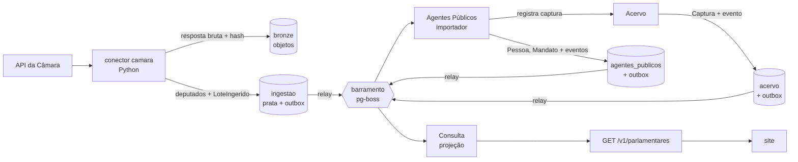

# Roteiro da v1

> A ordem das etapas segue um princípio: **provar a arquitetura inteira cedo, com pouco código**, e só
> depois multiplicar os módulos. Cada etapa atravessa todas as camadas (fonte oficial → bronze → prata →
> domínio → eventos → projeção → API → site) e termina com algo que funciona de ponta a ponta.

O que a v1 entrega e quais módulos cada entrega envolve está em
[visão geral da arquitetura](arquitetura/visao-geral.md#mapa-da-v1-para-os-módulos).

## Por que esta ordem

- **Fatia vertical antes de camada horizontal.** As decisões mais arriscadas (ADRs 0005 a 0009) só se
  provam juntas: conector, contrato prata, importador, outbox, barramento, projeção e revalidação do site.
  Testá-las cedo, com um único fluxo, é barato; descobrir um encaixe errado com nove módulos prontos não é.
- **Leitura de dados públicos antes de escrita editorial.** Dados oficiais não dependem de login. Os
  comandos editoriais (registrar promessa, publicar veredito) têm autor e só vão para a API depois de
  definido o controle de acesso ([ADR-0014](adr/0014-identidade-e-acesso.md)).
- **Proveniência desde o primeiro conector.** Nada vai ao ar sem captura ([ADR-0009](adr/0009-proveniencia-obrigatoria.md)).
  Adaptar conectores depois custa mais do que nascer certo.
- **Identidade primeiro.** Todos os contextos referenciam `PessoaId` e `MandatoId`; Agentes Públicos é a
  base dos demais.

## Etapas

| #   | Etapa                                       | Entrega                                                                                                                                                                           | Situação     |
| --- | ------------------------------------------- | --------------------------------------------------------------------------------------------------------------------------------------------------------------------------------- | ------------ |
| 0   | Domínio central: Compromissos               | Agregado `Promessa` (estágio, veredito, errata) e casos de uso, só com testes, sem infraestrutura.                                                                                | Concluída    |
| 1   | Fatia de ponta a ponta: deputados da Câmara | Conector da Câmara com captura; Agentes Públicos (`Pessoa`, `Mandato`); Acervo mínimo; outbox, barramento e inbox; projeção em Consulta; `GET /v1/parlamentares`; página no site. | Em andamento |
| 2   | Compromissos no banco e acesso editorial    | Repositório da `Promessa` com outbox; login e papéis (aceitar ADR-0014); painel mínimo de curadoria para cadastrar promessa e propor veredito.                                    | A fazer      |
| 3   | Atividade Legislativa                       | Proposições, votações e presença com o motivo da ausência (Câmara e Senado).                                                                                                      | A fazer      |
| 4   | Finanças Públicas e Obras                   | Emenda até a obra: empenho, pagamento, situação e medição da obra.                                                                                                                | A fazer      |
| 5   | Compromissos ligado aos fatos               | Sugestão de vínculos a partir dos eventos de Legislativo, Finanças e Obras; reavaliação do estágio.                                                                               | A fazer      |
| 6   | Engajamento                                 | "Meu governo" por município, acompanhar político ou promessa, alertas.                                                                                                            | A fazer      |

Cada etapa só termina com CI verde, testes de integração contra Postgres real e documentação de domínio
e de contratos atualizada.

## Etapa 1 em detalhe

1. Contrato prata `camara_deputado` e conector com testes sobre respostas gravadas.
2. Infraestrutura comum: transação por contexto, outbox, relay, barramento e inbox (ADR-0015).
3. Acervo mínimo: `Captura` registrada de forma idempotente pelo hash (ADR-0016).
4. Agentes Públicos: `Pessoa` com identificadores externos, filiação e mandatos; importador da prata.
5. Consulta: projeção `parlamentar`, reconstruível a partir dos eventos.
6. API pública `/v1/parlamentares` e páginas de lista e perfil no site, com a fonte de cada dado.
7. Testes de integração com Postgres real no CI.

Fica para depois, de propósito: Senado e assembleias (mesmo contrato, novos conectores), CPF e resolução de
identidade entre fontes, revalidação sob demanda do site, observabilidade completa.
