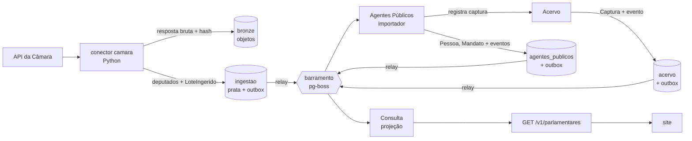

# Roteiro da v1

> A ordem das etapas segue um princípio: **provar a arquitetura inteira cedo, com pouco código**, e só
> depois multiplicar os módulos. Cada etapa atravessa todas as camadas (fonte oficial → bronze → prata →
> domínio → eventos → projeção → API → site) e termina com algo que funciona de ponta a ponta.

O que a v1 entrega e quais módulos cada entrega envolve está em
[visão geral da arquitetura](arquitetura/visao-geral.md#mapa-da-v1-para-os-módulos).

## Por que esta ordem

- **Fatia vertical antes de camada horizontal.** As decisões mais arriscadas (ADRs 0005 a 0009) só se
  provam juntas: conector, contrato prata, importador, outbox, barramento, projeção e revalidação do site.
  Testá-las cedo, com um único fluxo, é barato; descobrir um encaixe errado com nove módulos prontos não é.
- **Leitura de dados públicos antes de escrita editorial.** Dados oficiais não dependem de login. Os
  comandos editoriais (registrar promessa, publicar veredito) têm autor e só vão para a API depois de
  definido o controle de acesso ([ADR-0014](adr/0014-identidade-e-acesso.md)).
- **Proveniência desde o primeiro conector.** Nada vai ao ar sem captura ([ADR-0009](adr/0009-proveniencia-obrigatoria.md)).
  Adaptar conectores depois custa mais do que nascer certo.
- **Identidade primeiro.** Todos os contextos referenciam `PessoaId` e `MandatoId`; Agentes Públicos é a
  base dos demais.

## Etapas

| #   | Etapa                                       | Entrega                                                                                                                                                                           | Situação  |
| --- | ------------------------------------------- | --------------------------------------------------------------------------------------------------------------------------------------------------------------------------------- | --------- |
| 0   | Domínio central: Compromissos               | Agregado `Promessa` (estágio, veredito, errata) e casos de uso, só com testes, sem infraestrutura.                                                                                | Concluída |
| 1   | Fatia de ponta a ponta: deputados da Câmara | Conector da Câmara com captura; Agentes Públicos (`Pessoa`, `Mandato`); Acervo mínimo; outbox, barramento e inbox; projeção em Consulta; `GET /v1/parlamentares`; página no site. | Concluída |
| 2   | Compromissos no banco e acesso editorial    | Repositório da `Promessa` com outbox; login e papéis (aceitar ADR-0014); painel mínimo de curadoria para cadastrar promessa e propor veredito.                                    | Concluída |
| 3   | Atividade Legislativa                       | Proposições, votações e presença com o motivo da ausência (Câmara e Senado).                                                                                                      | Concluída |
| 4   | Finanças Públicas e Obras                   | Emenda até a obra: empenho, pagamento, situação e medição da obra.                                                                                                                | Concluída |
| 5   | Compromissos ligado aos fatos               | Sugestão de vínculos a partir dos eventos de Legislativo, Finanças e Obras; reavaliação do estágio.                                                                               | Concluída |
| 6   | Engajamento                                 | "Meu governo" por município, acompanhar político ou promessa, alertas.                                                                                                            | Em curso  |

Cada etapa só termina com CI verde, testes de integração contra Postgres real e documentação de domínio
e de contratos atualizada.

## Etapa 1 em detalhe

1. Contrato prata `camara_deputado` e conector com testes sobre respostas gravadas.
2. Infraestrutura comum: transação por contexto, outbox, relay, barramento e inbox (ADR-0015).
3. Acervo mínimo: `Captura` registrada de forma idempotente pelo hash (ADR-0016).
4. Agentes Públicos: `Pessoa` com identificadores externos, filiação e mandatos; importador da prata.
5. Consulta: projeção `parlamentar`, reconstruível a partir dos eventos.
6. API pública `/v1/parlamentares` e páginas de lista e perfil no site, com a fonte de cada dado.
7. Testes de integração com Postgres real no CI.

Resultado: com a API da Câmara real, 513 deputados chegaram da fonte ao site, com a captura de cada dado.
A coleta, a importação e a projeção levam menos de um minuto.

Fica para depois, de propósito: Senado e assembleias (mesmo contrato, novos conectores), CPF e resolução de
identidade entre fontes, revalidação sob demanda do site, observabilidade completa, comando para reconstruir
projeções, limite de requisições na API pública e gravação de respostas reais da Câmara como fixtures dos
testes de contrato.

## Etapa 2 em detalhe

- **Compromissos no banco:** repositório da `Promessa` com controle de versão (concorrência otimista),
  eventos na outbox e histórico de vereditos protegido por gatilho no banco (invariante 5).
- **Identidade:** Keycloak com o realm `prometeu` ([ADR-0014](adr/0014-identidade-e-acesso.md)). A API
  confere assinatura, emissor e audiência do token e exige papel por rota.
- **API editorial** (`/v1/editorial`): registrar promessa, adicionar fonte, capturar documento, propor,
  publicar e recusar veredito. O autor de cada ato vem do token, nunca do corpo da requisição.
- **Captura de documentos:** o Acervo baixa o documento da URL informada (só https, sem rede interna,
  conferindo o IP também na conexão), guarda pelo hash e registra a captura.
- **Painel de curadoria:** login com PKCE, sessão em cookie cifrado, lista de promessas, cadastro com
  captura da fonte, proposta, publicação e recusa de veredito.

Resultado: a jornada completa (login real, captura de uma página real, registro, proposta, recusa de "não
cumprida" com mandato em curso, publicação por outra pessoa) roda contra os serviços locais.

Fica para depois, de propósito: vínculos pelo painel (etapa 5), OTP obrigatório no realm de produção,
fila de revisão com filtros, renovação de sessão gravada também nas páginas (hoje só em ações e rotas) e o
sistema visual do painel.

## Etapa 3 em detalhe

A etapa é grande; vai em fatias, cada uma de ponta a ponta. A ordem começa pelo diferencial do produto (a
ausência com motivo) e deixa o Senado para quando os senadores estiverem em Agentes Públicos.

| Fatia | Entrega                                                                                                                                        | Situação  |
| ----- | ---------------------------------------------------------------------------------------------------------------------------------------------- | --------- |
| 3.1   | Frequência no plenário da Câmara, com o motivo de cada ausência justificada: conector, `RegistroDeFrequencia`, projeção, API e perfil no site. | Concluída |
| 3.2   | Votações nominais do plenário da Câmara e o voto de cada deputado; antes, os períodos de exercício dos deputados (inclusive suplentes).        | Concluída |
| 3.3   | Senado: senadores e seus exercícios em Agentes Públicos, votações nominais e quem não votou, com o motivo, em cada votação.                    | Concluída |
| 3.4   | Proposições normativas (PEC, PLP, PL, MPV, PDL) da Câmara e do Senado: autoria, situação e tramitação, ligadas às votações.                    | Concluída |

### Fatia 3.1: frequência na Câmara

- **Fonte:** a API de Dados Abertos v2 não publica a justificativa da ausência. Ela só existe no serviço
  legado SitCamaraWS (`ListarPresencasParlamentar`), consultado por matrícula. O conector também grava a
  correspondência entre matrícula e id da API v2. Cada consulta leva vários segundos; quatro correm ao
  mesmo tempo.
- **Janela:** a justificativa costuma chegar dias depois da sessão, então cada execução revisita os
  últimos 30 dias. Regravar o dia atualiza a prata, e o domínio transforma a mudança em retificação.
- **Domínio:** `RegistroDeFrequencia` por pessoa, casa e dia de sessão. Só a ausência justificada tem
  motivo; o dia precisa cair dentro do mandato, que Agentes Públicos informa pelo código da fonte.
- **Falta de dado não é falta:** a Câmara responde 404 para algumas matrículas, e o conector não grava
  nada. A API conta dias com sessão registrados; dia sem registro não entra em nenhuma conta.
- **Leitura:** `GET /v1/parlamentares/{pessoaId}/frequencia?de=&ate=` (padrão: últimos 90 dias) e a
  seção "Presença no plenário" no perfil, com o motivo e a fonte de cada ausência.

Resultado: com o serviço real da Câmara, a coleta dos últimos 30 dias levou 28 minutos e trouxe 2.560 dias
de 513 deputados (o plenário quase não teve sessão durante a campanha eleitoral, então os dias começam em
13/10). A importação e a projeção levaram cerca de um minuto, sem nenhuma linha recusada: 49 ausências
justificadas (missão autorizada e licença para tratamento de saúde) e 56 sem justificativa.

Fica para depois, de propósito: o significado de "Presença (~)" (sem legenda pública; a grafia é
guardada e tratada como presença), frequência em comissões e o histórico anterior à janela de 30 dias
(uma carga inicial por legislatura).

### Fatia 3.2: votações nominais na Câmara

- **Pré-requisito descoberto na fonte:** as três votações nominais de outubro tinham votos de suplentes
  que já tinham saído do cargo, e Agentes Públicos só conhecia quem estava em exercício no dia da coleta.
  O conector de deputados passou a percorrer todos os deputados da legislatura e a ler o histórico de
  cada um (posse, licença, reassunção, afastamento). Cada período de exercício vira um mandato, como diz a
  definição do domínio; o mandato antigo, que cobria a legislatura inteira, é retificado para o primeiro
  exercício e mantém o id (`PeriodoDoMandatoRetificado`). A lista de parlamentares do site mostra só quem
  está no cargo hoje; quem saiu mantém o perfil.
- **Fonte:** `GET /api/v2/votacoes?idOrgao=180` lista as votações do plenário. Só as nominais têm votos
  (`/votacoes/{id}/votos`); o detalhe traz as proposições afetadas. Os votos de uma votação ficam numa
  linha da prata, para que uma correção da Câmara não deixe voto velho para trás. Na votação secreta a
  fonte diz quem votou, com o voto nulo.
- **Domínio:** `VotacaoNominal`, com o voto de cada parlamentar ligado ao mandato exercido no instante do
  voto. Um parlamentar desconhecido recusa a votação inteira, para que o placar nunca fique incompleto.
  Cada um vota uma vez, e o sigilo vale para todos os votos ou para nenhum.
- **Ausente não é inferido:** a Câmara não lista quem faltou à votação. No perfil entram as votações em
  que o parlamentar votou e as dos dias em que a casa apurou a frequência dele; sem voto, o site mostra
  como o dia foi apurado (presente, ausente, ausência justificada e o motivo), sem adivinhar.
- **Leitura:** `GET /v1/votacoes`, `GET /v1/votacoes/{votacaoId}` (placar, votos e as duas fontes) e
  `GET /v1/parlamentares/{pessoaId}/votos`; páginas "Votações nominais" e a seção no perfil.

Resultado: com a fonte real, o histórico de 648 deputados (incluindo 135 que já saíram) levou pouco mais
de um minuto e virou 963 mandatos, sem recusa: 513 mandatos antigos foram retificados e a lista do site
continuou com 513 em exercício. A coleta das votações de agosto a outubro trouxe 11 votações nominais
(uma secreta, com 466 votos sem conteúdo) e nenhuma recusada; os placares batem com a descrição da
Câmara.

Fica para depois, de propósito: orientação de bancada (`/votacoes/{id}/orientacoes`), votações em
comissões, a frequência dos suplentes que já saíram (o serviço legado só lista quem está em exercício) e
o vínculo da votação com a proposição, que vem na fatia 3.4.

### Fatia 3.3: Senado

- **Senadores:** como na Câmara, a lista de quem está em exercício não basta. O conector percorre os
  senadores da legislatura em curso e lê os mandatos de cada um, que trazem os exercícios (início, fim e
  causa do afastamento). A UF vem do mandato: o detalhe de quem já saiu não a traz. A API do Senado
  recusa conexões quando recebe muitas consultas ao mesmo tempo; elas vão uma de cada vez (13 segundos
  para os 245 senadores da legislatura 57, 107 deles com exercício nela).
- **Exercício que se toca no mesmo dia:** o Senado às vezes encerra um exercício e abre o seguinte da
  mesma pessoa no mesmo dia (o titular renuncia e o suplente, que já estava no cargo, continua). A
  prata guarda as datas como vieram; Agentes Públicos junta os dois num mandato só.
- **Votações:** uma consulta traz as votações nominais da janela, cada uma com todos os senadores em
  exercício. Quem não votou vem com a situação: presente sem voto (`P-NRV`), não compareceu (`NCom`),
  ou ausente com motivo (`AP`, `LS`, `MIS`, `LP`, `LAP`). `NA` ("Dispositivo não citado") não tem
  legenda pública e é guardada como situação não informada.
- **Domínio:** `VotacaoNominal` passou a registrar, quando a casa informa, quem não votou e por quê
  (relação completa). Na Câmara a relação continua incompleta e nada é inferido. O Senado não informa
  horário: o voto vale para o mandato exercido no dia. Os eventos da votação foram para a v2 do
  contrato; a projeção lê a v1 e a v2.
- **Leitura:** `GET /v1/votacoes?casa=senado`, a lista "Não votaram" na página da votação e, no
  perfil, o motivo que a própria votação informa. O perfil do senador não mostra "Presença no
  plenário": a frequência diária do Senado não é coletada.

- **Licença antes da posse do suplente:** o Senado continua listando o titular de licença, com o motivo,
  até o suplente tomar posse, embora o exercício dele já tenha terminado. A ausência justificada fica
  ligada ao último exercício, encerrado pela licença; as outras situações exigem mandato no dia.

Resultado: com a fonte real, os 107 senadores com exercício na legislatura viraram 107 pessoas
(a última depois de traduzir `S/Partido`, como o Senado escreve "sem partido") e 81 em exercício, o
mesmo número da lista do Senado. As 190 votações nominais de 2025 e 2026 entraram todas, depois de tratar a licença
antes da posse do suplente, que recusava três votações: 15.390 registros (190 × 81), com 1.962 ausências
justificadas (atividade parlamentar, licença saúde, missão, licença particular, licença paternidade), 73
ausências sem justificativa e 2.391 presentes sem voto. Coletar de novo não gerou evento.

Fica para depois, de propósito: unificar a pessoa que foi deputada e virou senadora (as fontes não têm
identificador comum, e juntar pelo nome confundiria homônimos) e a frequência diária do Senado.

### Fatia 3.4: proposições

- **Recorte:** só os tipos que podem virar norma (PEC, PLP, PL, MPV e PDL). Requerimentos, pareceres e
  outros documentos de trâmite seriam metade do volume e não viram lei. Na Câmara, entram as
  proposições com tramitação nos últimos 3 dias; no Senado, os processos atualizados nesse período.
  Tramitação não muda depois de registrada, e três dias cobrem um fim de semana sem execução.
- **Fontes:** na Câmara, três consultas por proposição (detalhe, autores e tramitações), quatro ao
  mesmo tempo: com oito, a Câmara responde 429, e o cliente HTTP agora espera o que a fonte pede em
  `Retry-After`. No Senado, uma consulta por processo traz autoria, situação, histórico de situações e
  norma gerada.
- **O que a fonte ensinou:** a sequência da tramitação na Câmara não é única (dois despachos do mesmo
  ato repetem o número) e nem sempre acompanha a data; o importador ordena por data, de forma estável.
  No Senado, o código do autor só identifica senadores: um deputado autor vem com o código do Senado.
- **Domínio:** `Proposicao`, uma por casa. O autor parlamentar é ligado à pessoa quando Agentes
  Públicos o conhece; quem não é parlamentar conhecido (Poder Executivo, comissão, ex-parlamentar)
  fica com o nome da fonte. Ato novo depois dos conhecidos vira `TramitacaoAvancou`; outra correção da
  casa, `ProposicaoRetificada`.
- **Votação e proposição:** a votação aponta a matéria pelo código da casa; no Senado, as votações
  passaram a trazer o id do processo (contrato v1.1.0), o mesmo das proposições. A página da votação
  liga para a proposição quando ela já foi coletada, e a da proposição lista as votações.
- **Leitura:** `GET /v1/proposicoes?casa=&tipo=`, `GET /v1/proposicoes/{id}` e
  `GET /v1/parlamentares/{id}/proposicoes`; páginas de proposições, da proposição e a seção
  "Proposições de autoria" no perfil.

Resultado: com a fonte real, a coleta dos últimos 3 dias levou 12 minutos e trouxe 1.735 proposições da
Câmara e 271 do Senado, todas importadas sem recusa, com 18.681 atos de tramitação. Dos autores, 2.135 de
2.323 na Câmara e 335 de 555 no Senado ficaram ligados a pessoas; os demais são comissões, a Presidência
da República e ex-parlamentares. As 190 votações do Senado coletadas de novo passaram a apontar o
processo; 5 delas já ligam a uma proposição coletada, e o número cresce com a coleta diária.

Fica para depois, de propósito: ligar a mesma matéria nas duas casas, a carga histórica (só entra o
que se move desde o início da coleta), relatorias e as proposições acessórias (emendas, pareceres).

## Etapa 4 em detalhe

O caminho do dinheiro, em fatias de ponta a ponta. Começa pela emenda, que liga o parlamentar ao
orçamento, e chega à obra.

| Fatia | Entrega                                                                                                                        | Situação  |
| ----- | ------------------------------------------------------------------------------------------------------------------------------ | --------- |
| 4.1   | Emendas parlamentares do Portal da Transparência: autor, destinações e execução (empenhado, liquidado, pago e restos a pagar). | Concluída |
| 4.2   | Para quem o dinheiro foi: favorecidos e convênios de cada emenda, com o município de destino.                                  | Concluída |
| 4.3   | Obras: situação e medição, ligadas à emenda e à ação orçamentária que as pagam.                                                | Concluída |

### Fatia 4.1: emendas parlamentares

- **Fonte:** o arquivo único de emendas do Portal da Transparência (um ZIP com um CSV em latin-1),
  coletado por inteiro todo dia. Entram os orçamentos de 2023 em diante. Cada linha é uma destinação
  (localidade e classificação orçamentária, até o plano orçamentário) com a execução acumulada; as
  linhas do mesmo código formam a emenda. Valores viram centavos inteiros já na plataforma de dados.
- **O que a fonte ensinou:** o Portal junta o tipo da emenda e a modalidade no mesmo campo, linha a
  linha, e 55 emendas individuais têm destinações nas duas modalidades. O tipo ficou na emenda
  (`individual`, `bancada`, `comissao`, `relator`) e a modalidade (`finalidade_definida` ou
  `transferencia_especial`, a "emenda PIX") em cada destinação. Município e UF sem código IBGE vêm
  como `Sem informação`, `-1` ou `-14` e ficam nulos.
- **Autor:** o Portal identifica o parlamentar só pelo nome. Agentes Públicos, que decide quem é quem,
  oferece os parlamentares em exercício num período; a emenda é ligada quando o nome normalizado
  corresponde a um único deputado ou senador em exercício quando as emendas são apresentadas: de 31
  de agosto (prazo de envio do projeto de orçamento) ao fim do ano anterior ao do orçamento. Sem
  correspondência única, fica o nome da fonte, sem recusar a emenda.
- **Legislatura anterior:** o primeiro orçamento de cada legislatura é emendado pela que termina. Os
  conectores de deputados e senadores coletam a legislatura em curso e a anterior (contratos prata
  `camara` v2.1 e `senado` v1.1), e o importador da Câmara aplica as legislaturas do mesmo deputado de
  uma vez, para que o reeleito que mudou de partido não troque de partido e volte a cada lote. A
  janela de apresentação também evita que janeiro do ano de troca de legislatura traga duas vezes
  quem passou da Câmara para o Senado.
- **Domínio:** `Emenda`, com as destinações e a execução em `Dinheiro`. Valores novos da fonte viram
  `ExecucaoDaEmendaAtualizada`; outra correção (destino, classificação, modalidade, autor),
  `EmendaRetificada`. Só o estorno de restos a pagar cancelados pode ser negativo.
- **Leitura:** `GET /v1/emendas?ano=&tipo=&uf=`, `GET /v1/emendas/{id}` e
  `GET /v1/parlamentares/{id}/emendas`, com a execução somada de todas as emendas do autor. Valores
  em centavos, como texto. No site, a lista, a página da emenda e a seção "Emendas ao orçamento" no
  perfil; "pago até agora" soma o pago no ano e os restos a pagar pagos depois.

Resultado: com a fonte real, a coleta levou 33 segundos e a importação, um minuto: 25.131 emendas, todas
importadas sem recusa. As individuais somam cerca de R$ 24 bilhões empenhados por ano. Com a legislatura
anterior, Agentes Públicos ganhou 281 deputados e 51 senadores (0 recusados, nenhuma troca de partido
falsa), e 99% dos autores de emendas individuais ficaram ligados a pessoas: 23.642 de 23.854, e no
orçamento de 2023 5.556 de 5.575 (eram 522). As 19 que sobram em 2023 são de dois parlamentares cujo
nome no Portal difere do nome parlamentar na Câmara.

Fica para depois, de propósito: os orçamentos anteriores a 2023 e juntar numa só pessoa quem passou
da Câmara para o Senado (as fontes não têm um identificador em comum).

### Fatia 4.2: favorecidos e convênios

- **Fonte:** os outros dois CSVs do mesmo ZIP de emendas, coletados na mesma execução: quem recebeu
  o dinheiro de cada emenda, mês a mês, e os convênios que cada emenda paga. O conector das emendas
  passou a gravar três tabelas (contrato prata `portal_transparencia` v1.1).
- **O que a fonte ensinou:** o valor por favorecido é o recebido no mês, não acumulado, e pode ser
  negativo (estorno). Cada CNPJ tem um só nome e um só município. O mesmo convênio pode ser pago por
  várias emendas, e repete convenente, objeto, data e valor em todas; há convênios de 2020 pagos com
  emendas de 2023. A "inscrição genérica" mistura pessoas e empresas estrangeiras, e o Portal corta a
  grafia em parte das linhas.
- **Pessoas físicas:** o Portal publica nome e parte do CPF de quem recebe como pessoa física (bolsas,
  auxílios). Pela regra de LGPD da plataforma (dado de cidadão é o mínimo necessário), o conector as
  soma por emenda, mês e município, sem nome nem CPF, já na prata; o mesmo vale para a inscrição
  genérica e o favorecido sem informação. O domínio recusa favorecido somado com nome ou documento.
- **Domínio:** `FavorecidosDaEmenda` (os recebimentos de uma emenda, ligada pelo código da fonte, pois
  o lote pode chegar antes da emenda) e `Convenio` (pelo número, com as emendas que o pagam). Eventos
  `FavorecidosDaEmendaRegistrados`/`Atualizados` e `ConvenioRegistrado`/`Atualizado`, com o estado
  completo; a mesma lista repetida pela fonte não vira evento.
- **Leitura:** `GET /v1/emendas/{id}` ganhou `favorecidos` (cada favorecido com o total recebido e o
  primeiro e o último mês) e `convenios`. No site, as seções "Para quem o dinheiro foi" e
  "Convênios" na página da emenda.

Resultado: com a fonte real, a coleta das três tabelas levou pouco mais de um minuto, e a importação,
cerca de um minuto: 22.600 listas de favorecidos e 16.989 convênios (R$ 18,9 bilhões), nenhum
recusado. Os favorecidos receberam R$ 133,2 bilhões desde março de 2023, 99% do que as emendas pagaram
(R$ 134,6 bilhões), quase tudo a 33.268 pessoas jurídicas. Cerca de 45 mil pagamentos a pessoas físicas
(R$ 60 milhões) viraram 8.412 somas por município, sem nome. 544 convênios são pagos por mais de uma
emenda, e 210 emendas com pagamento ainda não têm favorecido no arquivo.

Fica para depois, de propósito: ligar o município do favorecido ao código IBGE (a fonte só dá o nome),
os favorecidos por parlamentar e por município, e o CNPJ do convenente (a fonte só dá o nome).

### Fatia 4.3: obras

- **Fonte:** a API pública de dados abertos do Obrasgov.br, o cadastro federal de projetos de
  investimento (MGI), sem chave. A API antiga (`api.obrasgov.gestao.gov.br`) sai do ar; a nova pagina
  com no máximo 200 itens, e uma página de projetos custa segundos.
- **A ligação com a emenda:** está no empenho. Parte dos empenhos de cada obra traz, no campo do autor
  da emenda, o código completo da emenda no Portal (às vezes como número decimal, `202360110003.0`).
  Não há heurística de nome nem de lugar: a obra entra só quando um empenho dela traz o código de uma
  emenda de 2023 em diante. A ação orçamentária vem da emenda e, quando a fonte informa, do empenho.
- **Coleta:** percorre os empenhos inteiros, busca um a um só os projetos ligados a emendas e lê
  inteiras, por página, a execução física, o histórico de paralisação e a localização. Agenda
  semanal: a coleta leva dezenas de minutos, e a obra muda devagar.
- **O que a fonte ensinou:** os campos `latitude` e `longitude` saem quebrados quando falta espaço no
  WKT (`POINT(-35.22 -9.01)` vira longitude `9.01)`), então o ponto é lido do WKT. A mesma geometria
  atravessa vários municípios. A execução física repete linhas idênticas entre páginas, e há medição
  acima de 100%, que fica como veio. A maior parte das obras ligadas está só cadastrada, sem execução.
- **Domínio:** `Obra` no contexto Obras, pelo projeto de investimento: situação (`planejada`,
  `em_execucao`, `paralisada`, `concluida`, `cancelada`, `inacabada`), medição mais recente,
  interrupções, municípios, investimento previsto e as emendas que a pagam. `ObraRegistrada` e
  `ObraAtualizada` trazem o estado completo; a passagem para paralisada vira também `ObraParalisada`,
  o fato que Compromissos vai acompanhar.
- **Leitura:** `GET /v1/obras?uf=&situacao=`, `GET /v1/obras/{id}` (com as emendas e os autores) e as
  obras de cada emenda em `GET /v1/emendas/{id}`. No site, a lista e a página da obra e a seção
  "Obras" na página da emenda.

Resultado: com a fonte real, a coleta levou 36 minutos e a importação, cerca de dois: 10.121 obras
ligadas a 1.077 emendas, nenhuma recusada, com R$ 19,6 bilhões de investimento previsto. 1.071 dessas
emendas já estão no Prometeu; 1.725 obras são pagas com emendas individuais, de 342 parlamentares. A
maioria está só cadastrada: 6.590 planejadas, 2.536 em execução, 878 concluídas, 91 canceladas, 14
inacabadas e 12 paralisadas; 3.461 têm medição. O histórico repetia a mesma paralisação até 130 vezes
com identificadores diferentes: o importador fica com uma.

Fica para depois, de propósito: o painel de obras paralisadas do TCU, as fotos e contratos das obras,
as emendas que só aparecem na descrição do empenho (texto livre) e as obras de emendas anteriores a 2023.

## Antes da etapa 5: história, operação e busca

O balanço depois da etapa 4 apontou três lacunas antes de ligar as promessas aos fatos: o legislativo
raso (duas semanas de frequência ao lado de três anos de emendas), nada rodando sozinho e nenhuma busca
por nome ou lugar.

- **Carga histórica do legislativo:** o job `carga_historica` do Dagster coleta um período em partes do
  tamanho que cada fonte aceita, uma parte por lote (votações da Câmara: até 3 meses por consulta; do
  Senado: até 1 ano; a frequência da Câmara devolve a legislatura inteira de cada deputado numa
  consulta). Recomeçar uma parte não muda nada: a prata é gravada por chave e os importadores são
  idempotentes.
- **O que a fonte ensinou:** a lista de votações da Câmara traz votação que a própria API diz não
  existir (404 nos votos e no detalhe): ela fica de fora sem parar a coleta. E a Câmara registra voto
  de suplente minutos depois do afastamento automático lançado no mesmo dia (27/04/2023: afastamento às
  12h53, voto às 13h27). O voto passa a ser conferido pelo mandato que toca o dia da votação, como a
  frequência; a pessoa repetida continua recusada.
- **Operação:** as agendas nascem ligadas (o Dagster as deixa paradas até alguém ligar à mão); o daemon
  e a interface do Dagster sobem no perfil `dados` do compose; cada coleta que falha avisa por um
  webhook de chat (`ALERTA_WEBHOOK_URL`). A página pública `/fontes` (e `GET /v1/fontes`) mostra a
  última coleta de cada tabela de cada fonte e se a agenda está em dia. O comando `reentregar` do worker
  devolve eventos à fila para um consumidor: importar de novo um lote depois de corrigir o importador,
  ou alimentar desde o começo uma projeção nova, sem mexer no banco à mão.
- **Busca:** parlamentar e obra pelo nome, sem importar acento nem maiúsculas (a busca por nome de
  parlamentar acha também quem já deixou o cargo); emendas e obras por município (código IBGE); e os
  municípios pelo nome, a partir dos que aparecem como destino de emenda ou local de obra. No site, a
  busca única na página inicial (`/busca`) e a página de cada município, com as obras e as emendas
  destinadas a ele.

Resultado: com as fontes reais, a carga levou 30 segundos no Senado (16 partes), 35 minutos na
frequência da Câmara (uma consulta por deputado) e pouco mais de uma hora nas votações da Câmara (46
partes, retomada da parte 30 depois de a API ficar fora do ar). Desde fevereiro de 2023 entraram 1.060
votações nominais da Câmara e 426 do Senado, com 462.680 votos, e 184.413 dias de frequência de 513
deputados (10.736 ausências justificadas, com o motivo). A carga revelou que o conector de deputados
perdia períodos de exercício: a Câmara lança a volta do suplente com a situação `CONVOCADO` e a
descrição `Entrada - Reassunção`, e 309 de 704 votações eram recusadas por falta de mandato. Corrigido
o conector, recusadas ficaram 19 votações e 3 dias de frequência, de 4 deputados em 5 dias em que o
histórico da própria Câmara não registra exercício. A busca por município cobre 4.209 municípios.

Fica para depois, de propósito: a carga histórica das proposições (milhares por ano na Câmara, e o
Senado só aceita os últimos 30 dias), a frequência de quem saiu da Câmara antes da coleta (o serviço só
lista quem está no cargo), a lista oficial de municípios do IBGE (hoje só os que aparecem nos dados) e
um painel de métricas das coletas.

## Etapa 5 em detalhe

A promessa encontra os fatos. A plataforma aponta e avisa; quem liga a promessa ao fato e quem julga é
a curadoria (ADR-0010).

| Fatia | Entrega                                                                                                       | Situação  |
| ----- | ------------------------------------------------------------------------------------------------------------- | --------- |
| 5.1   | Vínculos pelo painel: candidatos do autor ordenados pelas palavras em comum, sugerir, confirmar e rejeitar.   | Concluída |
| 5.2   | Reavaliação: fato com vínculo confirmado que muda na fonte abre pedido na promessa, até a curadoria concluir. | Concluída |

### Fatia 5.1: vínculos na curadoria

- **Consulta:** `candidatos.doAutor` lê as proposições de autoria da pessoa, as emendas que ela indicou e
  as obras pagas por essas emendas, e ordena pelas palavras em comum com o texto da promessa: sem
  acento, sem palavras vazias, sem o plural e pela raiz de seis letras ("asfaltar" encontra
  "pavimentação asfáltica"). Até 15 de cada tipo, com os estágios que cada fato pode comprovar.
- **API editorial:** `GET promessas/:id/candidatos` (marca o que já está vinculado), `POST
promessas/:id/vinculos` (só curador; a evidência é a captura do próprio fato na Consulta), e
  `POST .../vinculos/:id/confirmacao` e `.../rejeicao`.
- **Painel:** a promessa mostra os vínculos, com confirmar, rejeitar e desfazer, e os fatos do autor que
  ainda não foram ligados. As capturas dos vínculos confirmados entram como evidência do veredito.

### Fatia 5.2: reavaliação

- **Domínio:** a promessa guarda os pedidos de reavaliação (`ReavaliacaoSolicitada`), só para fato com
  vínculo confirmado, sem repetir o mesmo motivo pendente e sem mexer em estágio ou veredito; a curadoria
  conclui todos de uma vez (`ReavaliacaoConcluida`).
- **Política:** o consumidor `compromissos.reavaliar_promessas` traduz `TramitacaoAvancou` (último passo
  da tramitação), `ExecucaoDaEmendaAtualizada` (total pago até agora), `ObraParalisada` (data e
  justificativa) e `ObraAtualizada` em situação final (concluída, cancelada, inacabada) em um motivo de
  uma frase, com a captura do estado novo.
- **API e painel:** `POST promessas/:id/reavaliacao/conclusao`; a promessa mostra os fatos que mudaram e
  o botão "Marcar como reavaliada", e a lista inicial conta as pendências de cada promessa.

Resultado: com os dados reais, uma promessa de "asfaltar as vias urbanas dos municípios gaúchos" traz,
entre as 221 obras pagas por emendas de um senador do Rio Grande do Sul, primeiro as de pavimentação
asfáltica em vias urbanas (80% das palavras em comum).

Fica para depois, de propósito: a sugestão automática de vínculo (`sugestao_ia`) quando chega uma
proposição, emenda ou obra nova do autor, que pede um critério de semelhança melhor que palavras em
comum; a tarefa de veredito final quando o mandato termina; e ações orçamentárias e atos normativos
como candidatos (ainda não há fonte para eles).

## Antes da etapa 6: identidade visual

A etapa 6 é a parte do cidadão, e o site ainda era HTML sem estilo. Três direções foram desenhadas sobre
a página real de um deputado; a escolhida está no [ADR-0017](adr/0017-identidade-visual.md): o nome
é o verbo, e a página de um político se lê em capítulos de cor plana, cada um aberto por um verbo no
pretérito (_Prometeu. Compareceu. Votou. Propôs. Indicou. Financiou._).

- **`packages/ui`:** tokens em variáveis CSS (quatro campos de cor, cinco tamanhos, uma família), uma
  folha de estilo e componentes de servidor: capítulo, cifra, proporção, calendário de presença e
  cadeia de entrega. A barra do topo toma a cor do capítulo que passa por baixo dela. Uma regra do
  dependency-cruiser impede o pacote de conhecer domínio, contratos ou apps.
- **Site:** a página inicial (busca, números reais de cada lista, fotos do Congresso, do Senado e da
  promulgação da Constituição) e a página do parlamentar em capítulos. As outras páginas herdam a
  base: listas em fichas, resumos em linhas, tabelas que viram fichas no telefone.
- **Obras por autor:** `GET /v1/obras?autor=<pessoa>` filtra as obras pagas por emendas da pessoa,
  para o capítulo _Financiou._
- **Verificado no navegador**, em 1440, 768 e 390 px, com o inspetor da skill de direção de arte: títulos em até duas linhas, uma família carregada, contraste dos textos, nada vazando
  para o lado.

Depois, as páginas de detalhe também viraram capítulos: a votação (_Aprovou._ ou _Rejeitou._ com o
placar, _Votaram._ com os nomes em colunas), a proposição (_Propuseram._, _Tramitou._ com os atos
antigos recolhidos, _Foi votada._), a emenda (_Pagou._ com as fases da despesa, _Destinou._,
_Chegou a._ com o ranking dos favorecidos, _Virou obra._) e a obra (_Executou._, _Parou._, _Foi
paga._). O painel de curadoria passou a usar o mesmo pacote, e a promessa mostra a cadeia de entrega
acesa até o estágio confirmado.

No acabamento, as listas (parlamentares, votações, proposições, emendas, obras, fontes, busca, Meu
governo e Minha conta) ganharam um topo comum na cor do assunto, com os filtros agrupados e a
paginação num componente só; o site ganhou páginas próprias de não encontrado e de erro; e o painel
foi conferido logado, em captura de tela, com os formulários no sistema. A conferência achou um erro
antigo: a lista do painel mostrava todo veredito como "não iniciada", porque a subconsulta comparava
a promessa com o `id` errado.

Fica para depois, de propósito: o modo escuro (os campos de cor são a identidade, e um tema escuro
pede outra escolha de campos); a busca no telefone dentro da barra; e fotos próprias dos municípios e
das obras, que não existem em acervo aberto.

## Etapa 6 em detalhe

A parte do cidadão: entrar pela própria cidade, acompanhar quem quiser e saber quando algo muda.

| Fatia | Entrega                                                                                                       | Situação  |
| ----- | ------------------------------------------------------------------------------------------------------------- | --------- |
| 6.1   | Meu governo: a cidade, o dinheiro de emenda que chegou, quem o mandou, as obras e a bancada que a representa. | Concluída |
| 6.2   | Acompanhar um político, uma promessa ou uma cidade, com conta de cidadão.                                     | Concluída |
| 6.3   | Alertas por e-mail do que mudou no que a pessoa acompanha.                                                    | A fazer   |

### Fatia 6.1: Meu governo

- **Consulta:** `municipios.autoresDeEmendas` soma, por autor, só as destinações de cada emenda ao
  próprio município (a parte que foi para outra cidade não conta) e ordena de quem mais pagou para
  quem menos. Emenda coletiva (bancada, comissão) aparece pelo nome, sem pessoa.
- **API:** `GET /v1/municipios/:codigoIbge/autores`.
- **Site:** `/municipios` procura a cidade pelo nome; a página da cidade se lê em capítulos:
  _Recebeu._ (pago e empenhado, e o ranking de quem mandou o dinheiro), _Virou obra._ (situação das
  obras pagas com emendas) e _Representam._ (os senadores e deputados federais em exercício eleitos
  pelo estado), com as listas completas no fim. "Meu governo" entra na barra do site e na página
  inicial.

Fica para depois, de propósito: prefeito e vereadores (pedem as fontes do TSE e das câmaras
municipais), a lista oficial de municípios do IBGE (hoje só os que aparecem nos dados) e o partido
da época de cada emenda (a página mostra o atual e diz isso).

### Fatia 6.2: acompanhar

- **Conta de cidadão:** cadastro aberto no Keycloak; toda conta nova recebe o papel `cidadao`. O site
  tem o próprio cliente OIDC (`site`) e o próprio cookie; o login do site e o do painel saem de um só
  pacote, `@prometeu/acesso` (código de autorização com PKCE, sessão em cookie cifrado, caminho de
  volta conferido para não virar redirecionamento aberto).
- **Engajamento:** o agregado `Cidadao` guarda o que a pessoa acompanha, até 200 políticos e cidades,
  pelo `sub` do login e mais nada. Grava só o que mudou, para duas abas não desfazerem uma a outra.
  Apagar os dados leva tudo (LGPD).
- **API:** `GET /v1/eu/acompanhamentos` (com nome e partido ou UF), `PUT` e `DELETE
/v1/eu/acompanhamentos/:tipo/:id` e `DELETE /v1/eu`, só com o papel `cidadao` e sem cache. Acompanhar
  confere na Consulta se o político ou a cidade existem.
- **Site:** o botão Acompanhar no topo do parlamentar e da cidade (sem login, leva a entrar e volta à
  mesma página) e a página Minha conta, com a lista, deixar de acompanhar e apagar os dados.

Verificado com o Keycloak e a API de verdade: cadastro visível na tela de login, login e volta para a
página certa, lista com os nomes, o clique em deixar de acompanhar (também sem JavaScript) e a ação
sem login levando a entrar, com um caminho de volta malicioso trocado pelo início.

Fica para depois, de propósito: acompanhar promessa (quando houver promessa publicada no site), o
login sem senha e a confirmação de e-mail (pedem servidor de e-mail) e excluir a conta de login pelo
próprio site (hoje apagar os dados leva o que a plataforma guarda; a conta no provedor continua).

**Tour de boas-vindas.** Logo depois do login, o site mostra um passeio de nove passos pelo que dá
para fazer: cada passo acende um item do cabeçalho (Meu governo, Parlamentares, Votações, Emendas,
Obras, a busca e Minha conta) e explica, em palavras simples, o que há ali. O `/retorno` deixa um
cookie curto quando o login dá certo; o navegador abre o tour uma vez e guarda que já viu. Minha
conta tem "Ver o tour de novo". No telefone, onde a navegação fica no rodapé, os passos ficam no meio
da tela e dizem isso; Minha conta entrou no rodapé. O cartão é um diálogo: foco no botão principal,
Tab preso nele, Esc fecha. Verificado no site com o Keycloak de verdade, no computador e no telefone.
